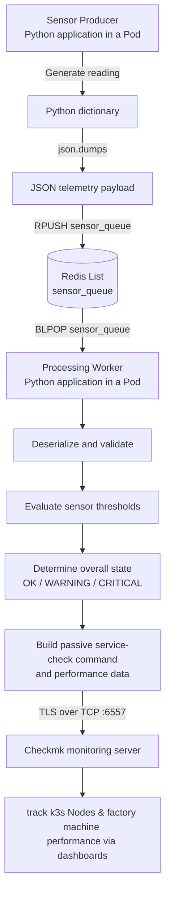
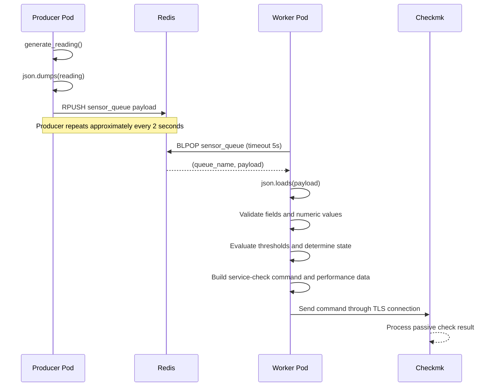
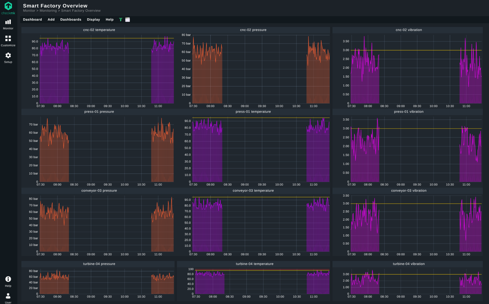
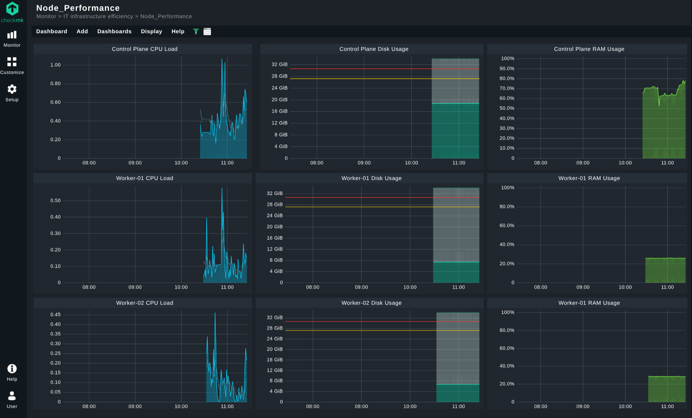

# Smart Factory IoT Telemetry Pipeline

A containerized, Kubernetes-orchestrated prototype that generates synthetic smart-factory sensor telemetry, buffers it in Redis, evaluates machine conditions in a Python processing worker, and submits passive service-check results and performance data to Checkmk over a TLS-protected TCP connection.

a minimalistic Flow diagram is available in the `/docs` directory !

> **Project status:** Learning / proof-of-concept implementation. The project demonstrates a distributed telemetry pipeline and monitoring integration. It is not yet a production-grade industrial IoT platform and does not currently ingest data from physical sensors or industrial protocols.

---

## Table of contents

- [1. Project overview](#1-project-overview)
- [2. Architecture](#2-architecture)
- [3. End-to-end data flow](#3-end-to-end-data-flow)
- [4. Components](#4-components)
  - [4.1 Sensor producer](#41-sensor-producer)
  - [4.2 Redis queue](#42-redis-queue)
  - [4.3 Processing worker](#43-processing-worker)
  - [4.4 Checkmk integration](#44-checkmk-integration)
  - [4.5 Kubernetes orchestration](#45-kubernetes-orchestration)
- [5. Telemetry message format](#5-telemetry-message-format)
- [6. Sensor thresholds and state evaluation](#6-sensor-thresholds-and-state-evaluation)
- [7. Checkmk result format and performance data](#7-checkmk-result-format-and-performance-data)
- [8. Configuration reference](#8-configuration-reference)
- [9. Repository layout](#9-repository-layout)
- [10. Prerequisites](#10-prerequisites)
- [11. Deployment](#11-deployment)
- [12. Verify the pipeline](#12-verify-the-pipeline)
- [13. Dashboard screenshots](#13-dashboard-screenshots)
---

## 1. Project overview

The project simulates a small factory containing four machines:

- `press-01`
- `cnc-02`
- `conveyor-03`
- `turbine-04`

A Python producer generates synthetic temperature, vibration, and pressure measurements. Each reading is serialized as JSON and appended to a Redis List. A separate Python worker consumes readings from that list, validates the payload, evaluates the sensor values against configurable warning and critical thresholds, and submits the resulting machine state to Checkmk.

Checkmk is used as the monitoring and visualization destination. The worker sends a passive service-check result containing a human-readable status message and performance data for the three measurements.

Checkmk will be tracking :
1. Generated Sensor data from the producer script (pressure, temperature , vibration) for the hypothetical machines mentioned above. 
2. performance readings ( CPU Load , Memory and Disk consumption) from the nodes running pods in the k3s architecture ( in our case that is the Control Node , Worker Node 1 running the producer app and Worker Node 2 running the worker app).

### Project objectives


- Build a small distributed application with separate producer and consumer workloads.
- Learn how containerized services communicate inside a Kubernetes cluster.
- Use Redis as an intermediary message queue to decouple data generation from data processing.
- Integrate an application-generated monitoring result with Checkmk.
- Use Kubernetes environment variables and Secrets to configure the workloads.
- Send monitoring results over a TLS-protected connection with server-certificate verification.
- Observe application behavior through Checkmk dashboards.


---

## 2. Architecture

The system is composed of three application stages. Redis is the message intermediary between the producer and worker. Checkmk is an external monitoring destination reached by the worker.



### Component responsibilities

| Component | Responsibility | Kubernetes / network role |
|---|---|---|
| Sensor producer | Generates synthetic telemetry and publishes JSON messages | Deployment in the `smart-factory` namespace |
| Redis | Buffers messages until a worker consumes them | Deployment plus internal `ClusterIP` Service on port `6379` |
| Processing worker | Consumes, validates, classifies, and forwards telemetry | Deployment in the `smart-factory` namespace |
| Checkmk | Receives passive check results and performance data | External endpoint configured as `192.168.0.252:6557` |
| Kubernetes / k3s | Schedules and runs the containers, injects configuration, and provides service discovery | Cluster orchestration layer |

### Network paths

1. **Producer → Redis:** The producer connects to `redis-service.smart-factory.svc.cluster.local:6379` using the Redis client library.
2. **Worker → Redis:** The worker connects to the same Kubernetes Service and consumes from the same Redis List.
3. **Worker → Checkmk:** The worker opens a TCP connection to the configured Checkmk address and port (`192.168.0.252:6557` in the supplied Deployment), validates the server certificate using a mounted CA file, and sends the command over TLS.

The Redis Service is `ClusterIP`, so it is intended for in-cluster communication. Checkmk is not deployed by the supplied Kubernetes manifests; it is treated as an external monitoring destination.

---

## 3. End-to-end data flow

The following sequence describes one telemetry reading from generation to monitoring.



### Step-by-step

1. The producer randomly selects one of the four machine identifiers.
2. It generates temperature, vibration, pressure, and a Unix timestamp.
3. `json.dumps()` serializes the Python dictionary into a JSON string.
4. `RPUSH` appends that string to the right side of the Redis List named `sensor_queue`.
5. The worker blocks on `BLPOP`, which removes and returns the oldest list item from the left side.
6. `json.loads()` converts the JSON string back into a Python dictionary.
7. The worker validates the payload and converts the sensor measurements to floating-point values.
8. It checks the values against the configured warning and critical thresholds.
9. It calculates one overall state: `0` (OK), `1` (WARNING), or `2` (CRITICAL).
10. It formats a Checkmk service-check command and attaches performance data.
11. It establishes a TLS connection to the configured Checkmk endpoint and sends the command.
12. Checkmk can display the result against the corresponding host and service, provided the server-side configuration contains the expected endpoint, host, and service setup.

### Why Redis is between the applications

Redis decouples data generation from data processing. The producer does not have to call the worker directly or wait for it to finish processing a reading. If the worker is temporarily stopped, the producer can continue adding messages to Redis, and the worker can consume pending messages after it returns.

The current implementation uses a Redis List as a simple FIFO queue:

- `RPUSH` appends a new item at the right-hand end.
- `BLPOP` removes the oldest item from the left-hand end.
- `LPUSH` puts a failed item back at the left-hand end for a retry attempt.

---

## 4. Components

### 4.1 Sensor producer

**Source file:** `producer.py` 

The producer is a continuously running Python application. Its job is to create synthetic sensor readings and publish them to Redis. It does not evaluate machine health and does not communicate with Checkmk.

#### Machine identifiers

```python
MACHINE_IDS = [
    "press-01",
    "cnc-02",
    "conveyor-03",
    "turbine-04"
]
```

Every reading randomly selects one machine from this list. The implementation does not run a dedicated producer per machine; each generated message may refer to any of the four machines.

#### Reading generation

```python
def generate_reading():
    return {
        "machine_id": random.choice(MACHINE_IDS),
        "temperature": round(random.uniform(60.0, 105.5), 2),
        "vibration": round(random.uniform(0.1, 4.5), 2),
        "pressure": round(random.uniform(30.0, 90.0), 2),
        "timestamp": time.time()
    }
```

The values are independently randomized within the ranges shown. Temperature is labelled in degrees Celsius by the worker's status output. 

The timestamp is generated using `time.time()`, which returns Unix time in seconds. The current worker does not use this field in its processing or Checkmk submission.

#### Publishing to Redis

```python
reading = generate_reading()
payload = json.dumps(reading)
r.rpush(QUEUE_NAME, payload)
time.sleep(2)
```

The producer serializes each dictionary as JSON, appends the payload to `sensor_queue`, and waits two seconds before generating the next reading. This is approximately 0.5 readings per second, before accounting for execution and network time.

#### Redis connection recovery

The producer creates a Redis client and verifies connectivity with `PING`. If the initial connection fails, it retries indefinitely using exponential backoff, capped at 30 seconds:

```python
wait_time = min(2 ** retries, 30)
time.sleep(wait_time)
```

If a Redis connection or timeout error occurs while sending, the producer reconnects. The current code does **not** explicitly retry the exact payload that encountered the send error; the next loop iteration generates another reading. Therefore, a reading may be lost when a send fails.

---

### 4.2 Redis queue

**Manifest:** `redis.yaml` 

Redis runs as a single-replica Kubernetes Deployment using the `redis:7-alpine` image. The manifest also defines a `ClusterIP` Service named `redis-service`.

| Setting | Value |
|---|---|
| Namespace | `smart-factory` |
| Deployment | `redis` |
| Container image | `redis:7-alpine` |
| Container port | `6379` |
| Service | `redis-service` |
| Service type | `ClusterIP` |
| Service port / target port | `6379` / `6379` |
| Replicas | `1` |
| Memory request / limit | `128Mi` / `256Mi` |
| CPU request / limit | `100m` / `500m` |

The Service provides a stable DNS name even if the Redis Pod is recreated:

```text
redis-service.smart-factory.svc.cluster.local:6379
```

The producer and worker both use the same queue name by default:

```python
QUEUE_NAME = os.getenv("QUEUE_NAME", "sensor_queue")
```


#### Queue operations

| Operation | Used by | Behavior |
|---|---|---|
| `RPUSH` | Producer | Adds a new telemetry payload to the right side of the list |
| `BLPOP` | Worker | Waits for an item and removes the leftmost item |
| `LPUSH` | Worker error handler | Returns a failed payload to the left side of the list |


The current Redis manifest does not configure a PersistentVolumeClaim, Redis persistence settings, authentication, replication, or a NetworkPolicy. Do not assume that queued messages will survive Redis Pod replacement.

---

### 4.3 Processing worker

**Source file:** `worker.py` 

The worker is the processing component. It continuously consumes telemetry from Redis, validates each message, determines the machine's health state, and submits the result to Checkmk.

Its work can be divided into five logical stages.

#### A. Configuration and threshold validation

The worker reads Redis, Checkmk, and sensor-threshold settings from environment variables. Defaults are also defined in Python so that the application has fallback values when variables are not supplied.

At startup, the worker validates the threshold hierarchy. For example, the temperature warning threshold must be lower than the critical threshold. The pressure boundaries must satisfy:

```python
PRESSURE_CRIT_LOW < PRESSURE_WARN_LOW \
    < PRESSURE_WARN_HIGH < PRESSURE_CRIT_HIGH
```

An invalid threshold hierarchy raises `ValueError` during module initialization and prevents the worker from starting with an inconsistent configuration.

#### B. Message deserialization and validation

The worker uses:

```python
data = json.loads(payload)
```

It expects a JSON object (a Python dictionary) with a non-empty `machine_id`. It converts temperature, vibration, and pressure to floats, then rejects values that are not finite numbers:

```python
values = (temperature, vibration, pressure)

if not all(math.isfinite(value) for value in values):
    raise ValueError("Sensor payload contains invalid numeric values")
```


#### C. Rule-based condition evaluation

The worker maintains two lists:

- `warning_reasons`: contains all warning-level findings.
- `critical_reasons`: contains all critical-level findings.

It evaluates the three measurements independently, then selects the most severe overall state. If any critical condition exists, the overall result is CRITICAL. Otherwise, if any warning exists, the result is WARNING. If neither list contains a finding, the result is OK.

#### D. Result construction

The worker creates:

- A human-readable status output describing the machine and sensor values.
- Performance data containing the measurement values and configured thresholds.
- A passive service-check command containing the target host, service description, and numeric state.

#### E. Checkmk submission

 When Checkmk integration is enabled, the worker sends the command through a TLS-wrapped TCP socket.

---

### 4.4 Checkmk integration

Checkmk is the monitoring destination. It is not defined as a Kubernetes workload in the supplied manifests.

The worker submits a passive service-check result using the command name:

```text
PROCESS_SERVICE_CHECK_RESULT
```

A passive result means the worker performs the sensor evaluation and sends the calculated state to Checkmk. Checkmk does not collect these synthetic sensor values directly from the machines in this project.

#### Target host and service

The default target host is the `machine_id` from the message:

```python
target_host = machine_id
```

The configured service description defaults to `Customcheck`.

For separate machine-level monitoring, the corresponding host names (`press-01`, `cnc-02`, `conveyor-03`, and `turbine-04`) and the intended service must be configured appropriately in Checkmk. 

#### TLS connection

The supplied Deployment configures:

```text
CHECKMK_HOST             = 192.168.0.252
CHECKMK_PORT             = 6557
CHECKMK_TLS_SERVER_NAME  = cmk
CHECKMK_CA_FILE          = /etc/checkmk/ca.crt
```

The worker first opens a TCP connection to the configured IP and port. It then wraps the socket with a TLS context that trusts the CA certificate loaded from `/etc/checkmk/ca.crt`. The configured TLS server name (`cmk`) is used for certificate identity verification.

The CA file is provided through a read-only mount backed by a Kubernetes Secret named `checkmk-livestatus-ca` in the `smart-factory` namespace. The Secret must contain a key named `ca.crt` so that the expected file exists at `/etc/checkmk/ca.crt` inside the worker container.

---

### 4.5 Kubernetes orchestration

**Manifest:** `deployment.yaml` 

The manifest defines two Deployments in the `smart-factory` namespace:

| Deployment | Container | Image | Replicas |
|---|---|---|---:|
| `sensor-producer` | `producer` | `localhost/smart-factory-producer:latest` | 1 |
| `processing-worker` | `worker` | `localhost/smart-factory-worker:v3` | 1 |

Both Deployments use the Redis Service's fully qualified DNS name. The worker additionally receives Checkmk settings and sensor thresholds, and mounts the Checkmk CA Secret.

#### Resource requests and limits

| Workload | CPU request | CPU limit | Memory request | Memory limit |
|---|---:|---:|---:|---:|
| Producer | `50m` | `200m` | `64Mi` | `128Mi` |
| Worker | `100m` | `500m` | `128Mi` | `256Mi` |
| Redis | `100m` | `500m` | `128Mi` | `256Mi` |

These are Kubernetes scheduling requests and resource limits, not guaranteed actual consumption figures.

---

## 5. Telemetry message format

The producer publishes a JSON object with the following structure:

```json
{
  "machine_id": "cnc-02",
  "temperature": 98.5,
  "vibration": 3.4,
  "pressure": 75.0,
  "timestamp": 1794140100.123
}
```

The `redis-py` clients are created with `decode_responses=True`, so Redis text responses are returned as strings. The worker then deserializes the JSON string into a Python dictionary.

---

## 6. Sensor thresholds and state evaluation

The worker uses configurable thresholds. The values in the supplied Kubernetes Deployment are:

| Measurement | Warning threshold | Critical threshold |
|---|---|---|
| Temperature | `>= 95` | `>= 100` |
| Vibration | `>= 3.0` | `>= 4.0` |
| Pressure (low) | `< 40` | `< 35` |
| Pressure (high) | `> 80` | `> 85` |

The order of evaluation matters: critical conditions are checked before warning conditions.

### Effective classification boundaries

| Measurement | OK | WARNING | CRITICAL |
|---|---|---|---|
| Temperature | `< 95` | `>= 95` and `< 100` | `>= 100` |
| Vibration | `< 3.0` | `>= 3.0` and `< 4.0` | `>= 4.0` |
| Pressure | `>= 40` and `<= 80` | `>= 35` and `< 40`, or `> 80` and `<= 85` | `< 35` or `> 85` |

The overall state is selected using the highest severity found across all measurements:

| Numeric state | Check state | Rule |
|---:|---|---|
| `0` | OK | No warning or critical findings |
| `1` | WARNING | At least one warning and no critical findings |
| `2` | CRITICAL | At least one critical finding |

If a reading contains both warning and critical findings, the overall state is CRITICAL and the status text includes both sets of reasons.

> **Important:** These thresholds are demonstration values, not validated operating limits for real industrial equipment. Real limits must be established for the specific machine, sensor, process, units, and operating conditions.

---

## 7. Checkmk result format and performance data

The worker constructs a command using the configured host, service, state, status output, and performance data. The command has the following general structure:

```text
COMMAND [unix_timestamp] PROCESS_SERVICE_CHECK_RESULT;host;service;state;status_output | performance_data
```

The command is terminated with a newline before being sent.

### Example status output

```text
WARNING: Temperature elevated: 98.50 C; Vibration elevated: 3.40 - Machine cnc-02: Temperature=98.50 C, Vibration=3.40, Pressure=75.00
```

### Example performance data

```text
temperature=98.50;95;100;0;110
vibration=3.40;3.0;4.0;0;5
pressure=75.00;40:80;35:85;30;90
```

Performance data carries the metric name, current value, warning and critical thresholds, and minimum/maximum graphing range. Pressure uses lower and upper threshold ranges.

The human-readable status explains the worker's decision; the performance data gives Checkmk numerical values that can be used for performance visualization. The status decision is made in the Python worker. The values in the performance data should be kept consistent with the Python thresholds when configuration changes are made.

---

## 8. Configuration reference

The supplied Kubernetes Deployment explicitly sets most of the runtime values. The table below lists the worker settings and the corresponding code defaults.

### Redis settings

| Variable | Code default | Supplied Deployment |
|---|---|---|
| `REDIS_HOST` | `redis-service.smart-factory.svc.cluster.local` | `redis-service.smart-factory.svc.cluster.local` |
| `REDIS_PORT` | `6379` | `6379` |
| `QUEUE_NAME` | `sensor_queue` | `sensor_queue` |

### Checkmk settings

| Variable | Code default | Supplied Deployment |
|---|---|---|
| `CHECKMK_ENABLED` | `true` | `true` |
| `CHECKMK_HOST` | `192.168.0.252` | `192.168.0.252` |
| `CHECKMK_PORT` | `6557` | `6557` |
| `CHECKMK_TLS_SERVER_NAME` | `cmk` | `cmk` |
| `CHECKMK_CA_FILE` | `/etc/checkmk/ca.crt` | `/etc/checkmk/ca.crt` |
| `CHECKMK_SERVICE_DESCRIPTION` | `Customcheck` | `Customcheck` |

### Sensor thresholds

| Variable | Code default | Supplied Deployment |
|---|---:|---:|
| `TEMPERATURE_WARN` | `95` | `95` |
| `TEMPERATURE_CRIT` | `100` | `100` |
| `VIBRATION_WARN` | `3.0` | `3.0` |
| `VIBRATION_CRIT` | `4.0` | `4.0` |
| `PRESSURE_WARN_LOW` | `40` | `40` |
| `PRESSURE_WARN_HIGH` | `80` | `80` |
| `PRESSURE_CRIT_LOW` | `35` | `35` |
| `PRESSURE_CRIT_HIGH` | `85` | `85` |

`PYTHONUNBUFFERED=1` is set for the worker container so Python output is not held in standard-output buffers. The code also uses `flush=True` in its log statements.

---

## 9. Repository layout


```text
smart-factory-iot/
├── README.md
├── producer/
│   ├── producer.py
│   ├── requirements.txt
│   └── Containerfile
├── worker/
│   ├── worker.py
│   ├── requirements.txt
│   └── Containerfile
├── k3s/
│   ├── redis.yaml
│   └── deployment.yaml
└── docs/
    └── screenshots/
    # png files
```


---

## 10. Prerequisites


### Create the namespace

```bash
kubectl create namespace smart-factory
```

If the namespace already exists, Kubernetes will report that it already exists; in that case, continue.

### Create the Checkmk CA Secret

Use the CA certificate that should validate the Checkmk server certificate. The example below assumes the certificate is available locally at `./ca.crt`:

```bash
kubectl create secret generic checkmk-livestatus-ca \
  --namespace smart-factory \
  --from-file=ca.crt=./ca.crt
```

The key name `ca.crt` is important because the worker expects the file `/etc/checkmk/ca.crt` after the Secret is mounted. 

---

## 11. Deployment

The following commands assume the suggested repository layout from [Repository layout](#9-repository-layout). Change the filenames if yours differ.

### 1. Apply Redis

```bash
kubectl apply -f k3s/redis.yaml
```

### 2. Apply the producer and worker Deployments

```bash
kubectl apply -f k3s/deployment.yaml
```

The deployment manifest contains two Kubernetes Deployment documents: `sensor-producer` and `processing-worker`.

### 3. Check the resources

```bash
kubectl get deployments -n smart-factory
kubectl get pods -n smart-factory -o wide
kubectl get services -n smart-factory
```

The expected application workloads are:

```text
redis
sensor-producer
processing-worker
```

Redis should have a Service named `redis-service` listening on port `6379`.

### 4. Check image and Secret availability if a Pod does not start

```bash
kubectl describe pods -n smart-factory
kubectl get secret checkmk-livestatus-ca -n smart-factory
```


### 5. Check application logs

```bash
kubectl logs -f deployment/sensor-producer -n smart-factory
```

```bash
kubectl logs -f deployment/processing-worker -n smart-factory
```

The producer should report a successful Redis connection and log generated payloads. The worker should report a successful Redis connection and then show its processing and Checkmk-submission messages.

---

## 12. Verify the pipeline

### Check the Checkmk result

In Checkmk, verify that:

- The target host exists and matches the worker's target host name.
- The `Customcheck` service exists and is configured to receive the passive result.
- The service state changes in response to submitted readings.
- The service output contains the machine identifier and sensor values.
- Performance data is available for temperature, vibration, and pressure.

---

## 13. Dashboard screenshots


### Smart factory overview (sensor readings)





### Node performance graphs





---
Y.